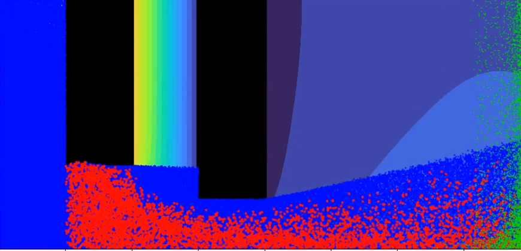

<p align="center">
  
</p>

<h1 align="center">
  Python Beam Extraction & Monte Carlo Simulator (PY-BEMCS)
</h1>

<p align="center">
  <strong>A high-fidelity 2D3V electrostatic Particle-in-Cell (PIC) & Monte Carlo Collision (MCC) simulation suite for gridded ion thrusters, neutral beam injectors (NBI), and advanced plasma extraction systems.</strong>
</p>

<p align="center">
  <a href="#-repository-overview">Repository Overview</a> •
  <a href="#-key-features--capabilities">Key Features</a> •
  <a href="#-numerical-controls--physics-validation">Physics Controls</a> •
  <a href="#-py-bemcs-demos">Demos</a> •
  <a href="#-installation--setup">Installation</a> •
  <a href="#-usage-workflows">Usage</a> •
  <a href="#-configuration-guide-configjson">Configuration</a> •
  <a href="#-multi-core-benchmarks">Benchmarks</a> •
  <a href="#-credits--authorship">Credits</a> •
  <a href="#-license--citation">Citation</a>
</p>

---

## 📁 Repository Overview

This repository includes a comprehensive multi-tier simulation ecosystem:

- **Python Digital Twin (Latest Modular Implementation — Version 2.0)**
  - **GUI Application (`Python/main.py`):** Interactive PyQt5 desktop suite featuring live plasma visualization, multi-grid optics geometry editor, RF co-extraction controls, IEDF/EEDF diagnostics, cross-section manager, and an in-app PyInstaller `.exe` compiler.
  - **Physics Engine (`Python/physics_engine.py`):** High-performance `DigitalTwinSimulator` featuring a dual-kernel architecture (Taichi GPU acceleration + pure-NumPy CPU fallback), 2D3V Boris particle pusher, SuperLU/CuPy Poisson solver, in-situ sputter erosion, thermal conduction, and automated numerical validation checks.
  - **Headless Batch Runner (`Python/run_simulation_from_config.py`):** Cluster- and CLI-friendly headless runner reading configuration from `Python/configurations/config.json` (or any specified config).
  - **Multi-Core Benchmarking Suite (`Python/benchmarks/`):** Parallel sweep scripts for CEX erosion rates, Electron Backstreaming (EBS) limits, primary beam grid impingement, and perveance-divergence curves.
  - **Documentation & User Manual (`Python/docs/`):** Complete LaTeX reference manual (`PY-BEMCS_Manual.tex`) and compiled PDF guide (`PY-BEMCS_Manual.pdf`).
- **Legacy Python Single-File App (`Python/transient_digital_twin.py`)**
  - Standalone monolithic GUI reference implementation.
- **Plume MCC Simulator (`Matlab/charge_exchange_code.m`)**
  - MATLAB model for CEX ion production, plume expansion, and downstream behavior with a custom Faraday probe model.
- **MATLAB Beam Extraction Model EOL (`Matlab/TransientDigitalTwin.m`)**
  - MATLAB test model for accelerated life testing, sputter erosion, and structural failure of accelerator grids.
- **C++ 3D PIC Framework (`Cpp3D/`)**
  - Full 3D Particle-In-Cell simulation with Qt6 GUI, VTK visualization, and OpenCASCADE STEP CAD import (under active development; see [`Cpp3D/README.md`](Cpp3D/README.md)).

---

## 🌟 Key Features & Capabilities

### 🌐 Non-Uniform Multi-Zone Mesh & Adaptive Field Solvers
- **Multi-Zone Non-Uniform Mesh:** 3 parametrizable geometric axial zones (Presheath, Optics Barrels, Plume) with adaptive coarsening factors (.0\times, 1.5\times, 2.0\times, 4.0\times$), cutting cell count and solve times by 25--35% while maintaining strict sub-Debye resolution.
- **Adaptive Picard & Newton-Raphson Solver:** Real-time residual tracking ($\Delta V_{\max} \le 50\text{ mV}$) that auto-scales Picard iterations and automatically engages a sticky Newton-Raphson fallback solver if stagnation occurs.
- **Automated Parametric Sweep Framework:** Multi-threaded and multi-process batch execution (SweepMixin, ParallelSweepWorker, and headless_sweep.py) with multi-metric steady-state convergence criteria.

### ⚡ Dual-Kernel Hardware Acceleration
- **Taichi GPU Acceleration:** Particle pusher (2D3V Boris algorithm), bilinear charge density deposition, and 2D thermal conduction run natively on GPU via Taichi (supporting Vulkan, CUDA, and Metal backends).
- **Vectorized CPU Fallback:** Seamless, pure-NumPy CPU fallback kernels ensure 100% functionality on CPU-only machines or within frozen executable bundles.
- **Sparse Poisson Field Solvers:** High-performance direct Poisson solving via SciPy SuperLU with optional GPU-accelerated CuPy sparse LU support.

### 🔬 Advanced Core Physics
- **Self-Consistent Beam Extraction:** Meniscus formation governed by upstream Bohm velocity criterion and sheath thermodynamics.
- **Coordinate Systems (Axisymmetric $r\text{--}z$ vs. Cartesian 2D Slab):** Toggle between 2D planar slit optics (`"cartesian"`) and true 3D circular beamlets (`"axisymmetric"`). The cylindrical solver incorporates exact annular control volumes ($V_{\mathrm{cell}} = 2\pi r \Delta r h_i^x$), L'Hôpital on-axis boundary handling ($c_{N,0} = 4.0$), Birdsall & Langdon local-Cartesian Boris rotation conserving angular momentum ($L_z = r v_\theta$) and transverse kinetic energy, and true 3D beamlet cone divergence ($\theta_{\mathrm{3D}} = \arctan2(\sqrt{v_r^2 + v_\theta^2}, v_x)$).
- **Specular Transverse Reflection:** In `half_hole` and axisymmetric modes, particles crossing the centerline ($y < 0$) or domain boundary ($y > L_y$) undergo physical specular reflection ($y \leftarrow -y, v_y \leftarrow -v_y$) rather than being deleted, preserving crossover trajectories and resolving low-perveance divergence underprediction.
- **Artificial Electron Mass Approximation:** Accelerated multi-scale time-stepping ($m_e = M_{\mathrm{ion}} / 100\dots 1000$).
- **Charge-Exchange (CEX) Collisions:** Monte Carlo collision modeling with probabilistic scattering (Birdsall/Roy model) and customizable cross-section data tables.
- **In-Situ Dynamic Sputter Erosion:** Real-time grid mass removal and hole geometry enlargement driven by primary and CEX ion impacts.
- **Decoupled Sub-Grid Structural Surface & 1D Radial Thermal Mesh:** Decouples physical grid boundaries, continuous Yamamura sputtering erosion, and 1D radial heat conduction from the background Eulerian PIC mesh. Sputtering recession ($\Delta d$) evolves continuously along analytical 1D boundary polylines without discrete staircasing or chunky cell-dropping.
- **Thermo-Mechanical Cantilever Grid Deflection:** Dynamic aperture distortion based on Euler–Bernoulli cantilever thermal expansion ($\delta = \frac{\alpha \Delta T L^2}{2t}$), with live mesh updating and Poisson refactorization.
- **RF Co-Extraction:** Modulated RF extraction potentials ($V_{\mathrm{RF}}\sin(2\pi f t)$) for simultaneous or alternating electron-ion beam extraction.
- **Neutralizer Electron Injection:** Configurable downstream electron injection rate and electron thermal temperature.
- **Arbitrary $N$-Grid Ion Optics:** Fully customizable multi-grid systems (Screen, Accel, Decel, Ground) with per-grid thickness, gap, aperture radius, chamfer angle, and DC potential.
- **Configurable Particle Injection Cutoff:** Option to specify finite injection windows (`inj_time_us`) for pulse extraction or decay studies.

### 📊 Live Diagnostics, Telemetry & GUI Tools
- **Live Visualizations:** Real-time ion/electron trajectory tracking, grid temperature heatmaps, sputter damage maps, and radial accelerator grid erosion groove profiles.
- **95th-Percentile Beam Divergence ($\theta_{95}$):** Continuous tracking of beam envelope divergence.
- **Saddle-Point Potential & EBS Monitoring:** Centerline saddle-point potential tracking to detect Electron Backstreaming risk barriers ($V_{\mathrm{saddle}} \le -5\,\text{V}$).
- **2D Plasma Density Visualizer (density_window.py):** Logarithmic 2D number density maps and radial density profiles at user-defined axial evaluation planes.
- **Steady-State Convergence Monitor (steady_state_window.py):** Real-time multi-variable rolling variance tracking ($\le 1.0\%$) with automated stabilization detection.
- **Energy Distribution Function Viewer (IEDF / EEDF):** Dedicated diagnostic window to inspect ion and electron energy spectra.
- **Cross-Section Manager:** Visual log-log cubic spline fitting and interpolation for custom Charge Exchange (CX), Secondary Electron Emission (SEE), and gas mixture interaction data.
- **Material Preset Library:** Built-in properties for Molybdenum, SS316 Stainless Steel, Titanium, and Graphite, with fully customizable thermal and sputtering coefficients.
- **Configurable Ion Species:** Mass (amu) and charge state presets (Xe, Kr, Ar, N2, O2, H2, He, Hg, Cs) or custom user-defined ions.
- **In-App Standalone Executable Builder:** Build single-file `.exe` packages directly from the menu (**Settings → Build .exe...**) using non-blocking background threads (`QThread`) with live progress milestone reporting.
- **Asynchronous Data Exports:** Export telemetry logs to CSV, full particle kinematics ($x, y, v_x, v_y, v_z, E$) to CSV, and multi-frame GIF recordings with live frame counters.

---

## 🔬 Numerical Controls & Physics Validation

When generating the simulation domain (`build_domain`), the physics engine automatically verifies the numerical and physical consistency of your grid resolution and time step:

1. **Debye Length Resolution ($\lambda_{\mathrm{D}}$)**:
   $$\lambda_{\mathrm{D}} = \sqrt{\frac{\varepsilon_0 T_{\mathrm{e,up}}}{e \cdot (0.61 n_0)}}, \qquad \Delta x \le \lambda_{\mathrm{D}} \quad \text{and} \quad \Delta y \le \lambda_{\mathrm{D}}$$
   Prevents unphysical numerical grid heating and non-physical space-charge oscillations.

2. **Plasma Frequency Integration Limit**:
   $$\omega_{\mathrm{pi}} = \sqrt{\frac{n_0 e^2}{m_{\mathrm{ion}} \varepsilon_0}}, \qquad \Delta t \le \frac{2\pi}{\omega_{\mathrm{pi}}}$$
   Ensures the temporal resolution captures collective plasma oscillations.

3. **Courant–Friedrichs–Lewy (CFL) Velocity Bound**:
   $$v_{\max} = v_{\mathrm{Bohm}} + 4 v_{\mathrm{thermal,i}} = \sqrt{\frac{Z e T_{\mathrm{e}}}{m_{\mathrm{ion}}}} + 4\sqrt{\frac{Z e T_{\mathrm{i}}}{m_{\mathrm{ion}}}}, \qquad \frac{\Delta x}{\Delta t} \ge v_{\max}, \quad \frac{\Delta y}{\Delta t} \ge v_{\max}$$
   Guarantees that particles do not traverse more than one mesh cell per time increment.

4. **Dynamic Domain & Geometry Modes**:
   - **Axial Domain Length:** $L_x = 1.5\,\text{mm} + \sum_k (t_k + g_k) + 3.0\,\text{mm}$ automatically computed from the grid geometry.
   - **`half_hole`:** Half-aperture domain with specular symmetry reflection at $y = 0$ (default, required for axisymmetric simulations).
   - **`one_hole`:** Full single-aperture extraction domain with periodic boundary conditions along $y$ (Cartesian 2D slab only).
   - **`two_holes`:** Dual-aperture coupling domain with periodic boundary conditions along $y$ (Cartesian 2D slab only).
   - **Why Multi-Hole Modes are Blocked in Axisymmetric Configuration:** In cylindrical coordinates ($r\text{--}z$), $r=0$ is the singular axis of rotational symmetry. Revolving an aperture located at $r > 0$ generates a hollow toroidal ring (donut-shaped channel) rather than a circular beamlet, while adjacent discrete holes break axisymmetry ($\partial/\partial\theta \ne 0$) and require a 3D solver. Furthermore, periodic boundary conditions along $r$ are physically meaningless because mapping $r = L_y$ to $r = 0$ couples cells of unequal volume and violates charge conservation. Therefore, Axisymmetric mode strictly constrains geometry to `half_hole`.
5. **Aperture & Injection Transverse Controls**:
   - **Hole-Boundary Distance (hole_boundary_dist_mm)**: Controls the minimum solid webbing margin between the outermost grid aperture wall and the top domain boundary $L_y$.
   - **Injection Y-Length (inj_y_length_mm)**: Controls the transverse/radial span across which upstream ions are injected at $x = 0$. By default, it equals the screen grid aperture radius $r_{\mathrm{screen}}$ (Auto button resets to $r_{\mathrm{screen}}$), but can be increased up to the domain height $L_y$ to model expanded Debye sheath curvature over the solid screen grid webbing at low plasma densities.

6. **Multi-Metric Steady-State Convergence & Stationarity Criterion**:
   To prevent premature scenario termination during sheath expansion or virtual anode oscillations, stationarity is evaluated simultaneously across four physical observables over a rolling window ($W = 100$ steps):
   $$\Delta Q[k] = \frac{Q[k] - Q[k-W]}{|Q[k-W]| + \epsilon} \times 100\%$$
   where $Q \in \{E_{\mathrm{tot}}, Q_{\mathrm{net}}, V_{\mathrm{saddle}}, I_{\mathrm{ion,exit}}\}$:
   - **Total System Energy ($E_{\mathrm{tot}}$)**: Sum of ion kinetic, electron kinetic, and electric field energies.
   - **Net System Charge ($Q_{\mathrm{net}}$)**: Sum of free particle charges and Boltzmann electron fluid charge.
   - **Saddle-Point Potential ($V_{\mathrm{saddle}}$)**: Midline potential barrier controlling electron backstreaming and meniscus shape.
   - **Exit Ion Beam Current ($I_{\mathrm{ion,exit}}$)**: Far-field Faraday cup current accumulated at the exit plane:
     $$I_{\mathrm{ion,exit}} = \frac{q_{\mathrm{ion}} w_{\mathrm{macro}} \sum_{\mathrm{exit}} 1}{\Delta t}$$
   Stationarity is declared when $\max(|\Delta E_{\mathrm{tot}}|, |\Delta Q_{\mathrm{net}}|, |\Delta V_{\mathrm{saddle}}|, |\Delta I_{\mathrm{ion,exit}}|) \le \varepsilon_{\mathrm{threshold}}$ (default $\le 1.0\%$), subject to minimum $k \ge 500$ post-entry iterations and bounded by $k_{\max} = 5000$.

7. **Child-Langmuir Perveance & Perveance Fraction Evaluation**:
   Evaluated across all parametric sweeps, headless batch scripts, and live telemetry to monitor extraction space-charge limits:
   - **Total Acceleration Potential**: $V_{\mathrm{tot}} = \max(V_{\mathrm{screen}} - V_{\mathrm{accel}}, \, 0.0)$
   - **Measured Effective Perveance**:
     $$P_{\mathrm{eff}} = \frac{I_{\mathrm{exit}}}{V_{\mathrm{tot}}^{3/2}} \quad [\text{A}/\text{V}^{1.5}]$$
   - **Theoretical Maximum Child-Langmuir Perveance** (Goebel & Katz formulation with equivalent acceleration length $l_e$):
     $$l_e^2 = (l_g + t_s)^2 + r_s^2, \qquad P_{\max} = \frac{4 \varepsilon_0}{9} \sqrt{\frac{2 q_{\mathrm{ion}}}{m_{\mathrm{ion}}}} \frac{A_{\mathrm{aperture}}}{l_e^2}$$
     where $l_g$ is grid gap, $t_s$ is screen thickness, $r_s$ is aperture radius, and $A_{\mathrm{aperture}}$ is the screen aperture open area ($\pi r_s^2$ in radial mode, $r_s \times 1\,\text{mm}$ in Cartesian half-slit mode). It is strictly defined by $r_s$ and invariant to domain size $L_y$.
   - **Perveance Fraction**:
     $$\Pi = \frac{P_{\mathrm{eff}}}{P_{\max}}$$
     Quantifies whether extraction is under-perveant ($\Pi \ll 0.2$), optimally collimated ($\Pi \approx 0.2\dots 0.6$), or approaching space-charge choking ($\Pi \to 1.0$).

8. **Decoupled Sub-Grid Structural Surface & 1D Radial Thermal Model**:
   Decouples physical grid boundaries and thermal diffusion from the background Eulerian PIC mesh:
   - **Analytical 1D Boundary Polylines**: Upstream face ($\hat{\mathbf{n}} = (-1, 0)$), aperture barrel / conical chamfer ($\hat{\mathbf{n}} = (-\sin\theta, -\cos\theta)$), and downstream face ($\hat{\mathbf{n}} = (+1, 0)$) with fine subgrid resolution ($\sim 5\dots 10\,\mu\text{m}$).
   - **Exact Incident Impact Angle**: $\cos\theta = \max\left(0.1, \frac{-\mathbf{v}\cdot\hat{\mathbf{n}}}{\|\mathbf{v}\|}\right)$.
   - **Continuous Yamamura Angular Sputtering**:
     $$Y(E, \theta) = Y_{\mathrm{coeff}} \max(0, E - E_{\mathrm{th}}) \min\left(3.0, \; \frac{1}{\cos\theta}\right), \qquad \Delta d = \frac{Y(E,\theta) w_{\mathrm{macro}}}{D_{\mathrm{thresh}}} \Delta y$$
     Replaces discrete cell-dropping, producing smooth continuous erosion depth profiles without staircasing.
   - **1D Radial Structural Thermal Continuum**: Solves radial metal conduction with Stefan-Boltzmann radiation cooling:
     $$\rho c_p t_{\mathrm{grid}} \frac{\partial T}{\partial t} = \frac{1}{r}\frac{\partial}{\partial r}\left(k t_{\mathrm{grid}} r \frac{\partial T}{\partial r}\right) + \dot{q}_{\mathrm{dep}}(r) - 2 \varepsilon \sigma (T^4 - 300^4)$$
     bounded by explicit numerical Fourier stability $\text{Fo} = \frac{\alpha \Delta t_{\mathrm{eff}}}{\Delta r^2} \le 0.20$, coupled with Euler-Bernoulli cantilever bending deflection $\delta_{\mathrm{cant}} = \frac{\alpha (\bar{T}-300) L_{\mathrm{cant}}^2}{2 t_{\mathrm{grid}}}$.

---

## 🎬 PY-BEMCS Demos

<p align="center">
  <i>Simulation demonstrating Xe+ beam extraction in a dual-grid ion optics system (Vscreen=1650V, Vaccel=-350V, n_plasma=1e16 m⁻³) without a neutralizer. Geometry and potential barriers dynamically evolve as primary and CEX ions erode the grids.</i>
</p>

<p align="center">
  <video src="https://github.com/user-attachments/assets/0c6d243d-daea-444e-beed-82dcb215ad47" width="500px" autoplay loop muted playsinline>
  </video>
</p>

---

<p align="center">
  <i>RF-based co-extraction of electrons and ions (m_e = m_Xe / 100).</i>
</p>

<p align="center">
  <video src="https://github.com/user-attachments/assets/ce1ca173-62e1-433d-aff4-9aaafdbe117a" width="500px" autoplay loop muted playsinline>
  </video>
</p>

---

<p align="center">
  <i>Space charge neutralization of an ion beam (Vs=800V, Va=-600V) under various electron injection rates.</i>
</p>

<p align="center">
  <video src="https://github.com/user-attachments/assets/f541d3a0-647e-4827-9dda-5e4ce4f7e235" width="500px" autoplay loop muted playsinline>
  </video>
</p>

---

## 🛠️ Grid Material Properties

Users can select built-in presets or configure custom thermophysical and sputtering properties:

| Material | $k$ (W/m·K) | $\rho$ (kg/m³) | $c_p$ (J/kg·K) | $\alpha$ (10⁻⁶/K) | $E$ (GPa) | $Y_{\mathrm{coeff}}$ | $E_{\mathrm{th}}$ (eV) |
|---|---|---|---|---|---|---|---|
| **Molybdenum** | 138.0 | 10 280 | 250 | 4.8 | 329 | 1.05e-4 | 30.0 |
| **Steel (SS316)** | 16.3 | 8 000 | 500 | 16.0 | 193 | 2.80e-4 | 25.0 |
| **Titanium** | 21.9 | 4 507 | 520 | 8.6 | 116 | 1.80e-4 | 20.0 |
| **Graphite** | 120.0 | 2 200 | 710 | 3.0 | 11 | 3.50e-4 | 15.0 |

---

## 🚀 Installation & Setup

### Python Workflow (Recommended)

#### 1. Create and Activate Virtual Environment
Python 3.10+ is required (Python 3.12 recommended).

```bash
# Navigate to the repository root
cd PY-BEMCS

# Linux / macOS
python3 -m venv Python/.venv
source Python/.venv/bin/activate

# Windows (PowerShell)
python -m venv Python\.venv
Python\.venv\Scripts\Activate.ps1
```

#### 2. Install Dependencies
```bash
pip install --upgrade pip
pip install numpy scipy matplotlib PyQt5 Pillow taichi pyinstaller
```

*(Optional for GPU Poisson)*: On Linux with NVIDIA CUDA 12:
```bash
pip install 'cupy-cuda12x<14' nvidia-cublas-cu12 nvidia-cusparse-cu12 nvidia-cusolver-cu12 nvidia-cuda-runtime-cu12
```

---

## 💻 Usage Workflows

### 1. Interactive Graphical Application (GUI)
Launch the primary PyQt5 GUI interface:
```bash
python Python/main.py
```
- **Hot-Reload Configurations:** Switch simulation parameters on the fly via **Settings → Open Config JSON...** or **Settings → Reload config.json**.
- **Build Standalone Executable:** Click **Settings → Build .exe...**, choose an output path, and track compilation.
- **Diagnostics & Windows:** Inspect energy spectra via **Show Energy Dist. (IEDF/EEDF)**, manage materials in **Materials → Grid Material...**, and inspect cross-sections in **Beam → Cross-Section Manager...**.

### 2. Headless Batch Execution via Configuration JSON
Run high-throughput simulations on remote clusters or headless servers:
```bash
python Python/run_simulation_from_config.py
# Or supply a specific configuration file:
python Python/run_simulation_from_config.py Python/configurations/configNSTAR.json
```

### 3. Parallel Multi-Core Benchmarking Sweeps
Execute parametric physics sweeps (each grid gap or operating point runs on an independent core):
```bash
python Python/benchmarks/benchmark_cex.py
python Python/benchmarks/benchmark_ebs.py
python Python/benchmarks/benchmark_impingement.py
python Python/benchmarks/benchmark_perveance.py
python Python/benchmarks/benchmark_perveance_Vs_Sweep.py
```

### 4. MATLAB Workflow
Prerequisite: MATLAB R2015b or newer. Open MATLAB in `Matlab/` and run:
```matlab
TransientDigitalTwin   % Accelerated grid erosion and EOL study
charge_exchange_code   % Plume expansion & CEX study
```

---

## ⚙️ Configuration Guide (`Python/configurations/config.json`)

Simulations are configured via JSON files in `Python/configurations/` (defaulting to `config.json`):

```json
{
  "beam_species": {
    "mass_amu": 131.293,
    "charge_state": 1
  },
  "grid_material": {
    "preset": "Molybdenum"
  },
  "advanced_settings": {
    "neut_x": 19.9,
    "neut_r": 3.0,
    "V_plasma_offset": 1000.0,
    "m_e_ratio": 1000.0,
    "Lx": 20.0,
    "Ly": 3.0
  },
  "simulation": {
    "coordinate_system": "axisymmetric",
    "n0_plasma": 7.73e17,
    "Te_up": 8.5,
    "Ti": 0.034,
    "Tn": 400.0,
    "n0": 5.27e18,
    "Accel": 0.5,
    "Thresh": 10000.0,
    "sim_mode": "Thermal",
    "geometry": "half_hole"
  },
  "rf_co_extraction": {
    "rf_enable": false,
    "rf_grid_idx": 0,
    "rf_freq": 13.56,
    "rf_amp": 500.0
  },
  "neutralizer": {
    "neut_rate": 0,
    "Te": 5.0
  },
  "grids": [
    { "V": 1300.0, "t": 1.2, "gap": 0.9, "r": 1.3, "cham": 20.0 },
    { "V": -150.0, "t": 0.6, "gap": 0.5, "r": 0.8, "cham": 0.0 },
    { "V": 50.0,   "t": 0.5, "gap": 4.0, "r": 1.2, "cham": 0.0 }
  ],
  "cross_sections": {
    "cx_file": "",
    "see_file": "",
    "custom_file": "",
    "spline_smoothing": 0.0
  },
  "terminal_output": {
    "grid_temperatures": true,
    "beam_divergence": true,
    "saddle_point_potential": true,
    "mean_particle_energy": true,
    "iteration_time": true
  }
}
```

---

## 📊 Multi-Core Benchmarking Suite

| Benchmark Script | Physics Parameter Swept | Objective |
| :--- | :--- | :--- |
| **`benchmark_cex.py`** | Neutral density ($n_{\mathrm{n}} = 10^{18}\dots 5\times 10^{19}\,\text{m}^{-3}$) | Quantify accelerator grid erosion rates from CEX ions across various grid gaps. |
| **`benchmark_ebs.py`** | Accelerator voltage ($V_{\mathrm{a}} = -400\dots 0\,\text{V}$) | Map centerline saddle-point potential against the $-5\,\text{V}$ Electron Backstreaming threshold. |
| **`benchmark_impingement.py`** | Plasma density / Perveance ($P = I_{\mathrm{ion}}/V_{\mathrm{tot}}^{3/2}$) | Measure primary beam interception and direct grid scraping fractions. |
| **`benchmark_perveance.py`** | Plasma density (60 points) | Trace perveance-divergence curves identifying underfocused, optimal, and overfocused regimes. |
| **`benchmark_perveance_Vs_Sweep.py`** | Screen voltage ($V_{\mathrm{s}} = 600\dots 2000\,\text{V}$) | Evaluate extraction voltage scaling on beam divergence at constant plasma density. |

---

## 👥 Credits & Authorship

- **Original Creator & Lead Author:**
  - **Dr. Bharat Singh Rawat** — [GitHub](https://github.com/Bharat26031992/PY-BEMCS) | [Email](mailto:bharat.bharat22@gmail.com)
- **Version 2.0 Architecture, Physics Controls & Diagnostic Extensions:**
  - **Nick Magrin** — [GitHub](https://github.com/nickmagrin-pixel/PY-BEMCS) | [Email](mailto:nick.magrin@gmail.com)

---

## 📄 License & Citation

This project is licensed under the **Creative Commons Attribution-NonCommercial 4.0 International License (CC BY-NC 4.0)**. 

You are free to use, share, and adapt this software for academic and non-commercial research, provided proper attribution is given.

[](https://creativecommons.org/licenses/by-nc/4.0/)

### Citation

If you use this software in your research, please cite:

```bibtex
@software{PY-BEMCS,
  author       = {Bharat Singh Rawat and Nick Magrin},
  title        = {Python Beam Extraction and Monte Carlo Simulator (PY-BEMCS)},
  year         = {2026},
  publisher    = {GitHub},
  journal      = {GitHub repository},
  howpublished = {\url{https://github.com/nickmagrin-pixel/PY-BEMCS}},
}
```

